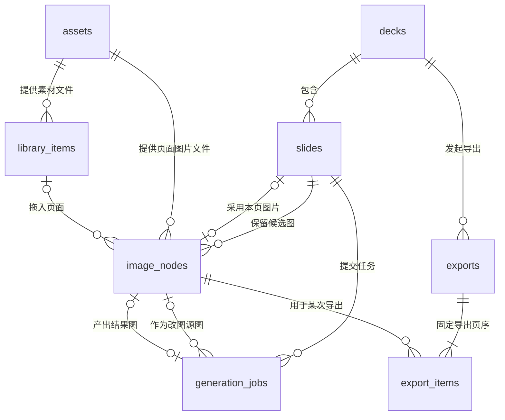

# 数据库设计

数据库版本 4，共 8 张业务表。页面当前要求直接存入 `slides`，每次生成时将要求复制进 Job。素材库保存图片名称和标签，拖入页面时建立图片节点并记录素材来源。

## 主要关系

| 关系 | 基数与含义 |
| --- | --- |
| `decks → slides` | 一对多，一份演示稿包含多个页面 |
| `slides → image_nodes` | 一对零到多，每页可以有多张候选图 |
| `slides.selected_node_id → image_nodes` | 每页最多采用一张本页图片，导出时使用 |
| `slides → generation_jobs` | 一对多，一页可以反复生成或改图 |
| `generation_jobs → image_nodes` | 一对零或一，成功任务产出一张图，上传和素材拖入的图片没有 Job |
| `image_nodes → generation_jobs.source_node_id` | 一张旧图可以作为多次改图任务的源图，源图必须与 Job 属于同页 |
| `assets → image_nodes / library_items` | 同一份文件可供多个节点和素材条目引用 |
| `library_items → image_nodes` | 一对多，每次拖入新增一条节点，记录 `library_item_id` |
| `decks → exports → export_items` | 导出记录下每页当时使用的节点与顺序 |

## 字段

ID 和整数金额使用 INTEGER，文本、JSON 和时间使用 TEXT。下表中的“可空”指允许 NULL。

### decks

| 字段 | 约束与含义 |
| --- | --- |
| `id` | 主键 |
| `title` | 必填，演示稿名称 |
| `style` | 必填，默认空字符串，整稿风格 |
| `created_at` | 必填，默认当前时间 |
| `deleted_at` | 可空，软删除时间 |

### slides

| 字段 | 约束与含义 |
| --- | --- |
| `id` | 主键 |
| `deck_id` | 必填，外键指向 `decks` |
| `position` | 必填，正整数，未删除页面在同一演示稿中页序唯一 |
| `title` | 必填，兼容原页面标题 |
| `selected_node_id` | 可空，复合外键 `(id, selected_node_id)` 指向 `image_nodes(slide_id, id)`，保证选图属于本页 |
| `page_type` | 必填，默认“内容” |
| `required_text` | 必填，默认空字符串，图片必须出现的文字 |
| `content` | 必填，默认空字符串，内容要求 |
| `local_style` | 必填，默认空字符串，本页风格 |
| `requirements_revision` | 必填，正整数，要求修改时递增，防止覆盖其他窗口的新改动 |
| `deleted_at` | 可空，软删除时间 |

保存相同要求不会增加版本号。版本号仅在本页内比较，历史要求由 Job 或上传节点的快照保存。

### assets

| 字段 | 约束与含义 |
| --- | --- |
| `id` | 主键 |
| `sha256` | 必填且唯一，用于文件去重 |
| `storage_key` | 必填且唯一，实际文件名 |
| `mime_type` | 必填，图片类型 |
| `width, height, byte_size` | 必填，尺寸和文件大小 |

### library_items

| 字段 | 约束与含义 |
| --- | --- |
| `id` | 主键 |
| `asset_id` | 必填，外键指向 `assets`，创建后不可替换 |
| `name` | 必填，1 到 100 字符 |
| `tags_json` | 必填，JSON 字符串列表，默认 `[]`；接口返回为 `tags` 数组 |
| `created_at` | 必填，默认当前时间 |
| `deleted_at` | 可空，素材软删除后已有页面图片继续可用 |

标签通过接口校验并去重，最多 20 个，每个 1 到 40 字符。允许相同文件对应不同命名的素材条目，底层文件共享，各条目分别统计使用次数。

### image_nodes

| 字段 | 约束与含义 |
| --- | --- |
| `id` | 主键，另有 `(slide_id, id)` 唯一约束供复合外键使用 |
| `slide_id` | 必填，外键指向 `slides` |
| `asset_id` | 必填，外键指向 `assets` |
| `job_id` | 可空且唯一，外键指向 `generation_jobs` |
| `library_item_id` | 可空，外键指向 `library_items`，只在素材拖入时填写 |
| `requirements_snapshot_json` | 可空，上传或拖入时必填，保存此时页面要求；生成图通过 Job 读取快照 |
| `created_at` | 必填，默认当前时间 |

图片节点不可 UPDATE。生成图必须对应本页正在运行的 Job，同一 Job 最多产生一张图。素材节点必须使用该素材的原始 `asset_id`，并且没有 Job。每次拖入分别插入一行，重复拖入允许产生多个节点。

旧图的修改关系沿 `image_nodes.job_id → generation_jobs.source_node_id` 追溯。API 仍派生返回 `parent_id` 和 `generation_job_id`，供当前前端使用。

`usage_count` 为引用该素材的节点数，查询时连接 `slides` 和 `decks`，只统计两者均未删除的记录。同页重复拖入分别计数，基于素材生成新图不增加次数。计数实时计算，删页、恢复页面和删除演示稿后都会随查询反映。

### generation_jobs

| 字段 | 约束与含义 |
| --- | --- |
| `id` | 主键 |
| `slide_id` | 必填，外键指向 `slides` |
| `source_node_id` | 可空，复合外键保证源图属于本页；空值表示新生成 |
| `retry_of_job_id` | 可空，外键指向被重试的旧 Job |
| `requirements_snapshot_json` | 必填，提交时的页面要求、版本号与整稿风格 |
| `instruction` | 必填，实际发送的提示词 |
| `provider, model` | 必填，提交时固定的服务商与模型 |
| `image_size` | 新任务提交时固定输出尺寸，旧任务未记录时可空，旧排队任务继续读取执行时的配置 |
| `provider_task_id` | 可空，供应商异步任务号，收到后立即记录 |
| `unit_price_cents` | 可空，提交时的单价，非负整数美分；未知价格留空 |
| `currency` | 必填，当前为 `USD` |
| `estimated_cost_cents` | 可空，成功后写入单价；未确认费用留空 |
| `billing_status` | 必填，`pending`、`estimated` 或 `unknown` |
| `status` | 必填，`queued`、`running`、`succeeded` 或 `failed` |
| `error_message` | 可空，失败原因 |
| `created_at` | 必填，默认当前时间 |
| `started_at, finished_at` | 可空，执行时间 |

任务输入及单价不可修改，状态、供应商任务号和费用随执行更新。成功任务必须有结果节点。重试新增一条 Job，复制旧要求、源图和提示词，使用重试时选择的模型、尺寸与单价。

单价来自用户提供的报价，`gpt-image-2` 为 10 美分，其余列出的四个 2.5/2.6 型号为 20 美分，本地演示为 0。成功按单价记估算费用，失败和超时保留 `pending`，其他未配置价格的模型为 `unknown`。演示稿成本包含其已删除页面中的任务，删除演示稿也保留任务与费用。

### exports

| 字段 | 约束与含义 |
| --- | --- |
| `id` | 主键 |
| `deck_id` | 必填，外键指向 `decks` |
| `format` | 必填，`pptx` 或 `pdf` |
| `status` | 必填，排队、运行、成功或失败 |
| `error_message` | 可空 |
| `created_at` | 必填，默认当前时间 |
| `finished_at` | 可空 |

### export_items

| 字段 | 约束与含义 |
| --- | --- |
| `export_id` | 外键指向 `exports` |
| `position` | 导出页序，与 `export_id` 组成主键 |
| `node_id` | 必填，外键指向 `image_nodes`，必须属于该演示稿 |

提交导出时复制每页选中图，后续换图和调整页序不会改写这次导出。

## 项目逻辑与使用方法

一份演示稿由按顺序排列的页面组成，每页可保留多张整页候选图。用户先决定如何得到候选图，再决定采用哪一张。导出时，后端按页序取出各页采用的图片。

### 1. 创建演示稿，编写各页要求

新建演示稿会写入一条 `decks`。整稿的视觉风格存入 `decks.style`。每添加一页，就写入一条 `slides`，通过 `deck_id` 归属该稿。页序由 `position` 控制，移动页面时保留页面 ID，因此已有图片和生成记录会跟随该页。

页面类型、必须出现的文字、内容要求和本页风格直接保存在该页。修改要求会递增本页的 `requirements_revision`。后续提交生成时，后端把这次使用的要求复制进 Job，所以可以同时查看“页面现在要求什么”和“旧图当时按什么要求生成”。

### 2. 给页面添加候选图

| 用户操作 | 后端写入 | 页面上得到什么 |
| --- | --- | --- |
| 上传到素材库 | 校验图片并按 SHA-256 查找或新增 `assets`，再写入 `library_items`，保存名称和标签 | 得到可跨页、跨稿复用的素材。仅入库时还没有页面节点 |
| 从素材库拖入某页 | 新增 `image_nodes`，写入目标 `slide_id`、素材的 `library_item_id` 和原来的 `asset_id` | 每拖一次增加一张候选图，文件可复用 |
| 直接上传到某页 | 查找或新增 `assets`，再新增本页的 `image_nodes`；来源素材和 Job 均为空 | 得到一张本页候选图，即使文件碰巧与库中素材相同，也不会增加素材拖入次数 |
| 生成新图或修改已有图 | 先写入 `generation_jobs`，成功后保存结果文件并写入带 `job_id` 的 `image_nodes` | 新结果与旧图并存，可以分别预览、采用或继续修改 |

素材列表按名称和标签筛选。接口返回的 `usage_count` 是实时统计值。例如同一素材拖到第 2 页两次、第 5 页一次，计数为 3。删除第 2 页后变为 1，恢复后回到 3。用户采用其中一张图、基于它改图或将它导出，都不会再次触发拖入计数。

### 3. 执行生成任务，记录单次费用

从头生成时，`source_node_id` 为空，后端将页面要求、整稿风格和补充说明组合为提示词。修改已有图时，该字段指向本页被修改的节点。用户填写修改指令就使用该指令；省略指令时，后端比较源图和当前页面的类型、必含文字、内容要求及本页风格，用差异生成指令。没有差异时，接口提示用户填写修改内容。

提交接口先返回 Job ID。后台按排队顺序领取任务，调用绘图服务。成功时在同一数据库事务中登记结果节点、标记 Job 成功并写入估算费用。失败时保存错误原因，可以用原提示词重试，新 Job 通过 `retry_of_job_id` 指向前次尝试。已定价付费任务失败或超时时，金额待确认。演示稿费用按所属页面汇总各 Job 已记录的金额，并单列待确认和未知的任务数。

### 4. 采用候选图，导出整份演示稿

用户点“采用这张”时，只更新本页的 `selected_node_id`。提交导出前，每个有效页面都要有采用图。后端按当前页序创建一条 `exports`，再为每一页创建一条 `export_items`，固定此次使用的节点。后台通过 `export_items.node_id → image_nodes.asset_id → assets.storage_key` 找到文件，依次写入 PPTX 或 PDF。

例如，素材“产品照片”拖到第 2 页后得到节点 31。用户以 31 为源图提交 Job 42，成功后得到节点 37。采用 37 时，更新的是第 2 页的 `selected_node_id`。假设这次导出编号为 8，则导出明细中有一行 `(export_id=8, position=2, node_id=37)`。第二天改为采用 31，第 8 次导出仍可追溯到 37。这个例子产生了一次素材拖入、一次生图任务和一条第 2 页的导出明细。

### 后端代码如何分工

| 职责 | 代码入口 | 用途 |
| --- | --- | --- |
| 接收请求与返回结果 | [Main.java](../src/main/java/studio/slidebranch/Main.java) | 解析接口请求，调用业务方法，返回记录 ID、详情、图片或导出文件，并调度生成与导出任务 |
| 组织一次用户操作 | [Studio.java](../src/main/java/studio/slidebranch/Studio.java) | 校验页面和图片归属，决定读写哪些表，将需要一起成功的写入放进同一事务 |
| 管理 SQLite | [Database.java](../src/main/java/studio/slidebranch/Database.java) | 升级数据库结构，执行查询、写入与事务 |
| 生成和保存图片 | [Images.java](../src/main/java/studio/slidebranch/Images.java) · [RightApi.java](../src/main/java/studio/slidebranch/RightApi.java) | 调用绘图服务，校验图片，计算文件哈希并写入图片目录 |
| 写出文件 | [ExportWriter.java](../src/main/java/studio/slidebranch/ExportWriter.java) | 按导出明细的顺序将整页图片写入 PPTX 或 PDF |

## 迁移与接口兼容

`library_jobs.sql` 在事务中重建 `slides`、`generation_jobs` 和 `image_nodes`，最后移除 `boards`，提交前执行外键检查。保留原来的页面、节点、Job、导出和采用记录 ID。旧 Job 保留原 board 的页面要求和最终提示词，旧上传节点保留原要求。旧库没有保存的历史整稿风格保留为 NULL，旧付费任务的价格与费用为未知，避免用当前价格回填历史。

当前前端继续通过 `/board` 保存要求，`board` 参数、`X-Board-Id` 和响应 `board_id` 对应页面要求版本号。新的接口使用 `/requirements`、`revision` 和 `X-Requirements-Revision`。兼容响应 `boards` 数组列出当前要求。生成图、素材拖入与上传仍需用户显式采用后才参与导出。

素材和计费接口详见 [README](../README.md)。
